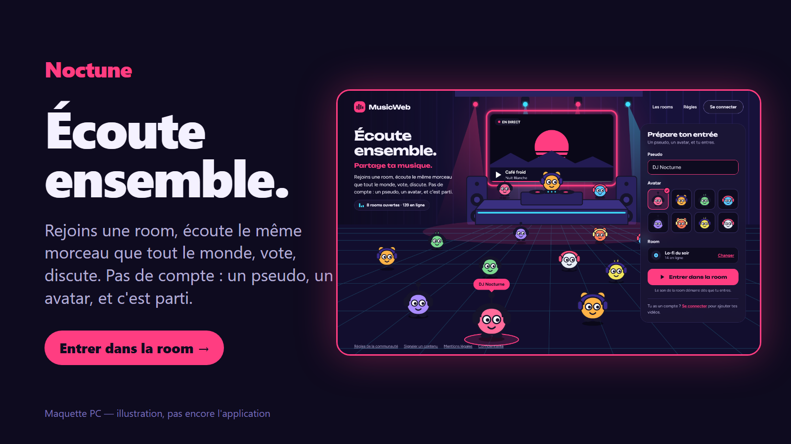
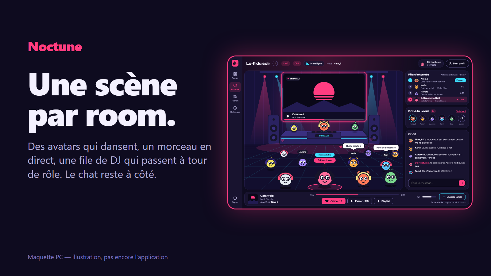
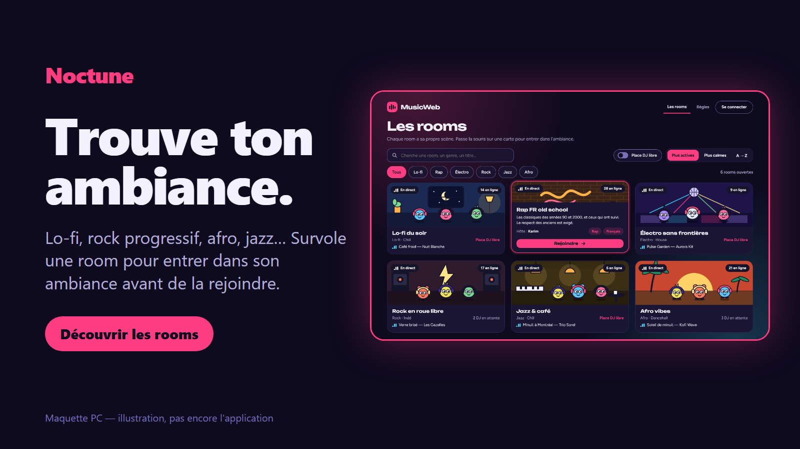

# Noctune

Plateforme musicale communautaire en PWA : des rooms publiques où l'on écoute le même morceau en même temps, on vote, on discute et on découvre de la musique. Pas de compte obligatoire, un pseudo et un avatar suffisent.

> Statut : en cours de conception. Les visuels ci-dessous sont des maquettes, pas encore l'application.







## Stack

- React 19, Vite, TypeScript
- PWA (`vite-plugin-pwa`)
- Serveur temps réel : Node, Socket.IO

## Lancer le projet

```bash
npm install
npm start            # site et serveur temps réel ensemble, puis ouvrir http://localhost:5173
```

Ctrl+C arrête tout. Pour lancer les deux séparément : `npm run dev` (site) et `npm run dev:server` (serveur sur :3001).
